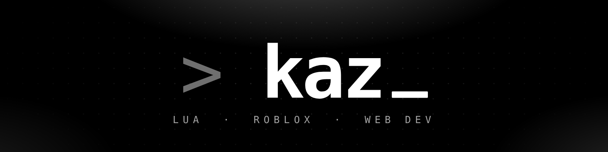
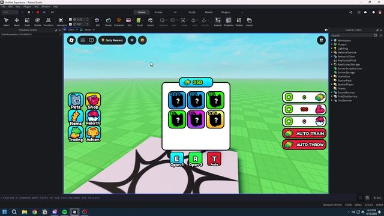
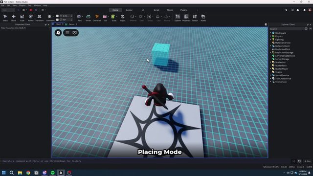
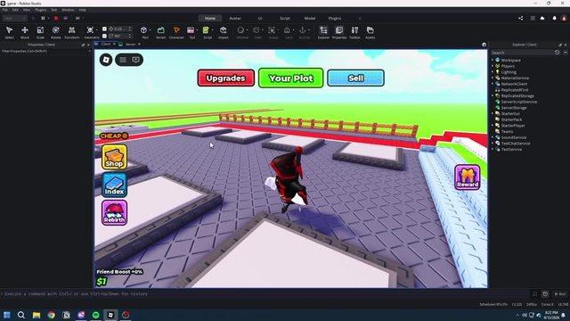
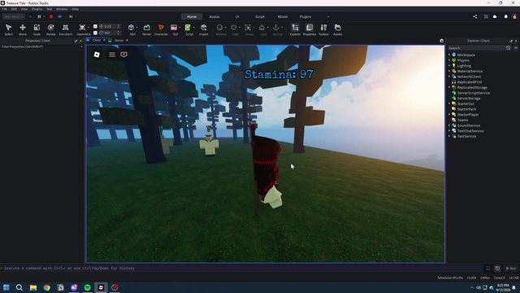
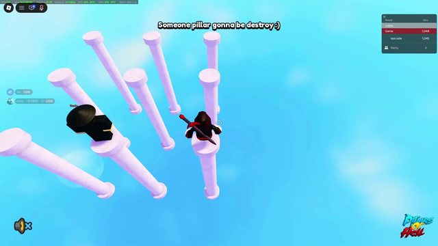

  

   kaz.build({ lua, roblox, web })" />

  

I'm **kaz**, a Lua developer with 3 years of experience.
I build Roblox systems, interfaces and gameplay, and I make websites with React and TypeScript.

- **Main language:** Lua / Luau
- **Front-end:** HTML, CSS, JavaScript, TypeScript, React
- **Back-end:** PHP, Python
- **Looking for:** commissions & developer jobs
- **Availability:** always available

  
  
  
  
  
  
  
  
  

<table>
  <tr>
    <td width="33%" valign="top">
       
      <b>Game UI & menus</b> 
      Pets, shop, rebirth, trading and auto-train / auto-throw buttons. 
      <code>Luau</code> <code>Roblox</code> <code>UI</code>
    </td>
    <td width="33%" valign="top">
       
      <b>Placing system</b> 
      A placement mode: pick a spot and place objects in the world. 
      <code>Luau</code> <code>Roblox</code> <code>Systems</code>
    </td>
    <td width="33%" valign="top">
       
      <b>Plot, shop & upgrades</b> 
      Player plot with shop, upgrades, sell buttons and a reward menu. 
      <code>Luau</code> <code>Roblox</code> <code>Systems</code>
    </td>
  </tr>
  <tr>
    <td width="33%" valign="top">
       
      <b>Stamina & gameplay</b> 
      Character gameplay with a live stamina bar and movement. 
      <code>Luau</code> <code>Roblox</code> <code>Gameplay</code>
    </td>
    <td width="33%" valign="top">
       
      <b>Obby gameplay</b> 
      Obby with moving pillars and a live leaderboard. 
      <code>Luau</code> <code>Roblox</code> <code>Obby</code>
    </td>
    <td width="33%"></td>
  </tr>
</table>

<table>
  <tr>
    <td width="50%" align="center">
      
    </td>
    <td width="50%" align="center">
      
    </td>
  </tr>
</table>

  
  
  

