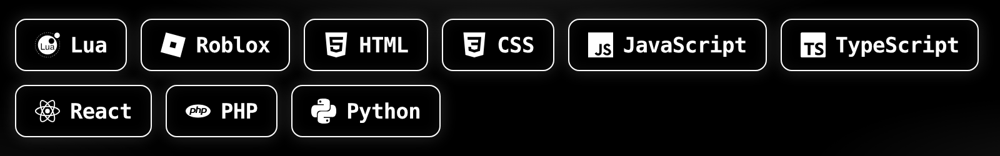
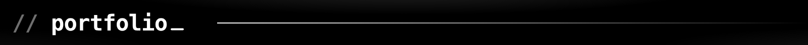
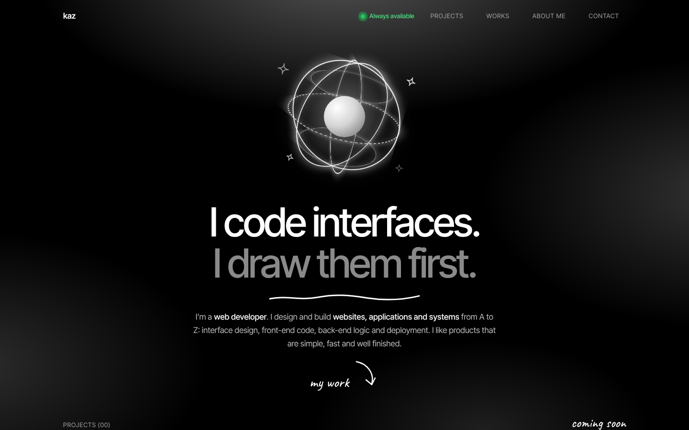
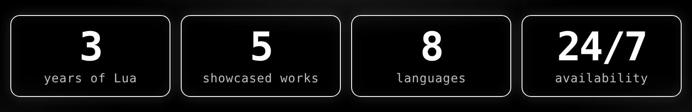
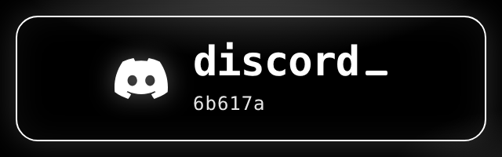
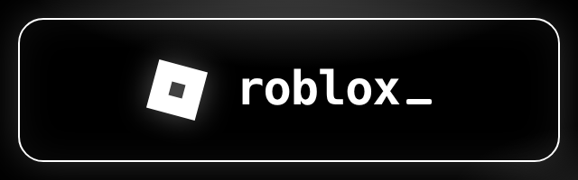
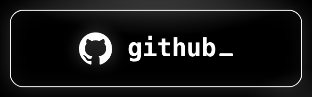
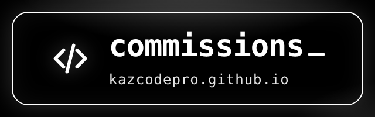

  

   kaz.build({ lua, roblox, web })" />

  

I'm **kaz**, a Lua developer with 3 years of experience.
I build Roblox systems, interfaces and gameplay, and I make websites with React and TypeScript.

- **Main language:** Lua / Luau
- **Front-end:** HTML, CSS, JavaScript, TypeScript, React
- **Back-end:** PHP, Python
- **Looking for:** commissions & developer jobs
- **Availability:** always available

  
  
  
  

